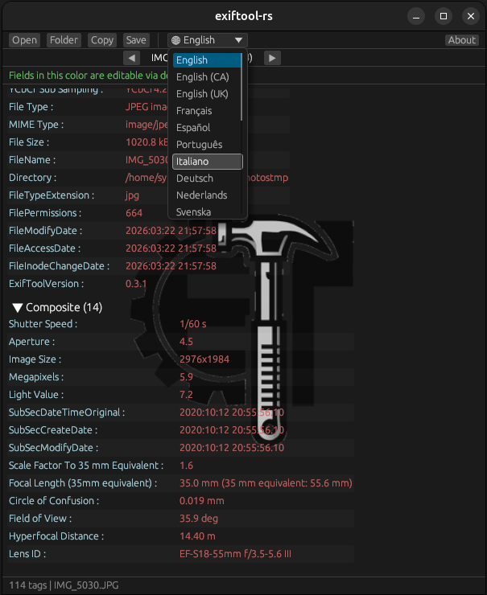

# exiftool-rs

[](https://crates.io/crates/exiftool-rs)
[](https://docs.rs/exiftool-rs)
[](https://le-syl21.github.io/exiftool-rs/)
[](LICENSE)
[](https://discord.gg/T37DYHmt2j)

A faithful Rust port of [ExifTool](https://exiftool.org/) 13.60 — read, write, and edit metadata in image, audio, video, and document files. ExifTool's own modules are embedded in the program and run by a Perl interpreter written in Rust, with ExifTool's subs and the `exiftool` application ported to Rust one by one: the output is ExifTool's, and no Perl installation is needed. The C libraries it needs (PCRE2, zlib) are built in.



## Community & support

Questions, bug reports, beta testing, or just want to chat? Join the Discord:

[](https://discord.gg/T37DYHmt2j)

## Features

- **ExifTool 13.60 itself**: every format, tag table, conversion, option and
  message is ExifTool's, run from its own code. ExifTool's test suite
  (`t/*.t`: 114 scripts, 604 tests) passes unchanged, every test image
  extracts identically, and the CLI is compared with Perl's `exiftool` case
  by case (see [Testing](#testing))
- **A CLI**, `exiftool-rs`, with every option of the `exiftool` application
- **A Rust API** (`exiftool_rs::ExifTool`) over Image::ExifTool, the same as
  the 0.x releases' (see [MIGRATION.md](MIGRATION.md) and
  [docs/port/API.md](docs/port/API.md))
- **Writers for what ExifTool only reads**: MP3/AIFF ID3, FLAC, Ogg, Opus
  and Matroska (`extra-writers` feature, on by default, API only)
- **Optional GUI** in 23 languages: ExifTool's 18 and Arabic, Bengali, Hindi
  and Portuguese

## How it compares to ExifTool

exiftool-rs runs ExifTool's own code, so what it reads, prints and writes is ExifTool's; the program is one compiled binary with no Perl installation behind it. How it is built: [docs/port/ARCHITECTURE.md](docs/port/ARCHITECTURE.md).

### Analysis engine

| | ExifTool (Perl) | exiftool-rs |
|---|---|---|
| Language | Perl 5, interpreted | ExifTool's Perl code, run by an interpreter in Rust; subs ported to Rust as natives |
| Tag tables | Perl hashes, loaded at runtime | The same, dumped from ExifTool's modules and embedded (`data/`) |
| `PrintConv` / `ValueConv` | Perl code, `eval`-uated at runtime | The same code, `eval`-uated by the interpreter |
| Runtime dependencies | Perl + CPAN modules | None: the optional Perl modules ExifTool uses are provided by the program |

### GUI

| | ExifTool (Perl) | exiftool-rs |
|---|---|---|
| Bundled GUI | None — CLI only | Yes — `exiftool-rs-gui` |
| Pseudo-official GUI | [ExifToolGUI](https://exiftool.org/gui/) — third-party, Windows-only, drives the CLI underneath | Native [egui](https://github.com/emilk/egui), single binary, cross-platform |
| Editing | via the third-party GUI | Double-click any writable tag, save back to file |
| Languages in the GUI | n/a | 23, descriptions and values localized |

### Languages

| | ExifTool (Perl) | exiftool-rs |
|---|---|---|
| Languages | 18 | 23 (adds Arabic, Bengali, Hindi, Portuguese) |
| Tag descriptions | ✅ | ✅ |
| PrintConv values (`Off` → `Arrêt`) | ✅ | ✅ — ExifTool's own `-lang` |
| Source | `Lang/*.pm` | `Lang/*.pm`, embedded; the four added languages from `locales/` |

## Supported Formats

Every format ExifTool 13.60 reads and writes, with ExifTool's maker notes and
timed metadata (`-ee`): `exiftool-rs -listf` lists the readable types,
`exiftool-rs -listwf` the writable ones, as `exiftool` does. Through the Rust
API, the `extra-writers` feature also writes MP3/AIFF (ID3), FLAC, Ogg, Opus
and Matroska, which ExifTool reads only.

## Library Usage

```rust
use exiftool_rs::ExifTool;

let et = ExifTool::new();
let tags = et.extract_info("photo.jpg").unwrap();
for tag in &tags {
    println!("{}: {}", tag.name, tag.print_value);
}
```

### Features

| Feature | Description |
|---------|-------------|
| `gui` | Enable the graphical interface (`exiftool-rs-gui` binary) |
| `extra-writers` | Writers for the types ExifTool reads and does not write (default) |
| `rusty-alloc` | rusty_alloc as the binaries' allocator (default; a library user can leave it out) |
| `win-icon` | Embed Windows application icon in the binary (CLI builds only) |

> **Note for library consumers:** The `win-icon` feature should only be enabled when building standalone binaries. If you use `exiftool-rs` as a library dependency, do **not** enable `win-icon` — it would inject a Windows VERSION resource into your own binary and cause linker conflicts.

## CLI Usage

```bash
# Install (CLI only)
cargo install exiftool-rs

# Install with GUI
cargo install exiftool-rs --features gui

# Read metadata
exiftool-rs photo.jpg

# Short tag names
exiftool-rs -s photo.jpg

# JSON output
exiftool-rs -j photo.jpg

# Write tags
exiftool-rs -Artist="John Doe" -Copyright="2024" photo.jpg

# Show groups
exiftool-rs -G photo.jpg

# Numeric values
exiftool-rs -n photo.jpg

# Extract embedded GPS from dashcam video
exiftool-rs -ee video.mp4
```

## GUI

exiftool-rs includes an optional graphical interface built with [egui](https://github.com/emilk/egui).

```bash
# Install with GUI support
cargo install exiftool-rs --features gui

# Launch the GUI
exiftool-rs-gui

# Or with a specific language
exiftool-rs-gui -lang fr
```

**Features:**
- Open files or folders, navigate with arrow keys
- View all metadata grouped by category
- Double-click any writable tag to edit it
- Copy all metadata to clipboard
- Save edits back to the file
- 23 languages supported (CJK, Arabic, Hindi, Bengali fonts included via [noto-fonts-dl](https://crates.io/crates/noto-fonts-dl))

### Supported Languages (23)

| Code | Language | Code | Language | Code | Language |
|------|----------|------|----------|------|----------|
| `en` | English | `fr` | French | `pl` | Polish |
| `ar` | Arabic | `hi` | Hindi | `pt` | Portuguese |
| `bn` | Bengali | `it` | Italian | `ru` | Russian |
| `cs` | Czech | `ja` | Japanese | `sk` | Slovak |
| `de` | German | `ko` | Korean | `sv` | Swedish |
| `en_ca` | English (CA) | `nl` | Dutch | `tr` | Turkish |
| `en_gb` | English (UK) | `fi` | Finnish | `zh` | Chinese (Simplified) |
| `es` | Spanish | | | `zh_tw` | Chinese (Traditional) |

Tag descriptions and PrintConv values are ExifTool's own translations (e.g. `Orientation` reads `Horizontale (normale)` under `-lang fr`), English where ExifTool has none; the four languages ExifTool does not have come from `locales/`.

### Platform Notes

| OS | Icon in binary | Notes |
|----|---------------|-------|
| **Windows** | Opt-in | Icon embedded in `.exe` via `winres` when `win-icon` feature is enabled |
| **macOS** | No | Requires a `.app` bundle with `.icns` |
| **Linux** | No | ELF binaries don't support embedded icons |

## CLI Options

Every option of ExifTool 13.60's `exiftool` application (`exiftool-rs -h`; [docs/port/CLI.md](docs/port/CLI.md)). The most used:

| Option | Description |
|--------|-------------|
| `-s` | Short tag names |
| `-s2` | Very short (tag names only) |
| `-G` | Show group names |
| `-n` | Numeric output (no print conversion) |
| `-j` | JSON output |
| `-csv` | CSV output |
| `-X` | XML/RDF output |
| `-b` | Binary output (thumbnails, etc.) |
| `-ee` | Extract embedded data (GPS from dashcams, etc.) |
| `-r` | Recursively scan directories |
| `-ext EXT` | Process only files with extension EXT |
| `-TAG` | Extract specific tag(s) |
| `-ver` | Show version |
| `-TAG=VALUE` | Write tag |
| `-TAG=` | Delete tag |
| `-overwrite_original` | Overwrite without backup |
| `-stay_open True` | Keep running, read commands from stdin |
| `-lang LANG` | Set language (GUI and tag descriptions) |
| `-v` | Verbose output |
| `-htmlDump` | HTML hex dump of file structure |
| `-validate` | Validate metadata |
| `-diff` | Show differences between files |
| `-args` | Print in ExifTool arg format |
| `-php` | PHP array output |
| `-progress` | Show progress during processing |
| `-scanForXMP` | Scan file for XMP data |

## Testing

```bash
# The crate's tests. Those that need Perl ExifTool's source tree (13.60) read
# it from $EXIFTOOL_DIR, or ../exiftool next to this repository, and are
# skipped without it.
EXIFTOOL_DIR=/path/to/exiftool cargo test --release

# The judges, against Perl ExifTool (docs/port/CLI.md)
bash scripts/run_suite.sh /path/to/exiftool       # ExifTool's t/*.t: 114 scripts, 604/604
bash scripts/compare_images.sh /path/to/exiftool  # every t/images file, extracted identically
cargo build --release --bin exiftool-rs
PORT_BIN=$PWD/target/release/exiftool-rs python3 -I scripts/compare_cli.py /path/to/exiftool
```

## Parity report

`src/bin/parity` (feature `parity`, needs `perl`, plus `curl` and `tar` to
fetch the pinned ExifTool release into `target/parity/`) runs exiftool-rs and
Perl ExifTool 13.60 over the corpus in `tests/images/` and compares them. The
[published report](https://le-syl21.github.io/exiftool-rs/) is generated from
it by `.github/workflows/pages.yml` on every release:

```bash
cargo run --release --features parity --bin parity                 # gate: fail on a new read delta or write failure
cargo run --release --features parity --bin parity -- --update     # refresh both baselines
cargo run --release --features parity --bin parity -- --dump \
  | python3 scripts/parity_report.py > index.html                   # the report page
```

The report has two parts.

- **Read**: every tag of every corpus file, as printed by `exiftool -s -G1`
  and by exiftool-rs (`Group1:Tag` and value), with an ISO column. Known
  deltas are listed in `tests/parity_live_baseline.txt`.
- **Write**: every corpus file whose type exiftool-rs writes (any file for
  which `write_info` does not answer "writing not yet supported") gets a few
  edits, chosen from what the file contains and the metadata families its
  writer handles: set an existing tag, add a tag, delete a tag, delete a whole
  group (`EXIF:all`, `GPS:all`, `XMP:all`, `IPTC:all`), and a mixed edit. The
  same edits are applied with `set_new_value` + `write_info` and with the
  ExifTool CLI. Both outputs are then re-read by Perl ExifTool
  (`-a -s -G0:1`, the independent referee), and ours also by exiftool-rs.
  Each case checks that the requested state is there, that the tags equal
  those of Perl's output, that our reader reads our file the way Perl does,
  and that Perl reports no new error or warning. A case where `write_info`
  returned `Ok` but the output is byte-identical, or a requested change is
  missing while Perl made it, is reported as a **silent no-op**, the most
  severe result. Known failing cases are listed in
  `tests/parity_write_baseline.txt`. The page lists the tags left out of the
  comparison: file-system and tool state (`FileModifyDate`, `FileSize`,
  `ExifToolVersion`, and so on), `XMPToolkit`, and the offsets of embedded
  images, which depend on the block layout.

The optional Perl modules ExifTool needs to decode the whole corpus are
checked at start (`Archive::Zip`, `IO::Compress::Brotli`,
`Compress::Raw::Lzma`, `POSIX::strptime`, `Unicode::LineBreak`).

## Building

```bash
git clone https://github.com/Le-Syl21/exiftool-rs
cd exiftool-rs

# CLI only
cargo build --release

# CLI + GUI
cargo build --release --features gui

# With Windows icon embedded in the .exe
cargo build --release --features win-icon
```

A C compiler is needed: PCRE2 (Perl's regular expressions) and zlib (so that
compressed output is byte for byte Perl's) are built into the program.

The `gui` feature is optional and not included by default. Without it, the GUI dependencies (egui, eframe, image, rfd, noto-fonts-dl) are not downloaded or compiled.

The `win-icon` feature embeds an icon into the Windows `.exe` via `winres`. It is disabled by default to avoid conflicts with frameworks like Tauri that manage their own Windows resources.

## License

GPL-3.0-or-later. Perl ExifTool, whose modules are embedded (`data/`), is free software under the same terms as Perl itself (GPL or Artistic License).

## Authors

- **Sylvain** ([@Le-Syl21](https://github.com/Le-Syl21)) — Project creator
- **Claude** (Anthropic) — Implementation

## Acknowledgements

Based on [ExifTool](https://exiftool.org/) by Phil Harvey.
Its modules, embedded in `data/`, are run by the port's interpreter.

Thanks to [RAW-Samples.ch](https://rawsamples.ch/), whose RAW files (metadata
only) make up our [`rawsamples` test corpus](tests/corpus/README.md), and to
[julyx10](https://github.com/julyx10), author of
[Lap](https://github.com/julyx10/lap), for many detailed reports and much
testing.
